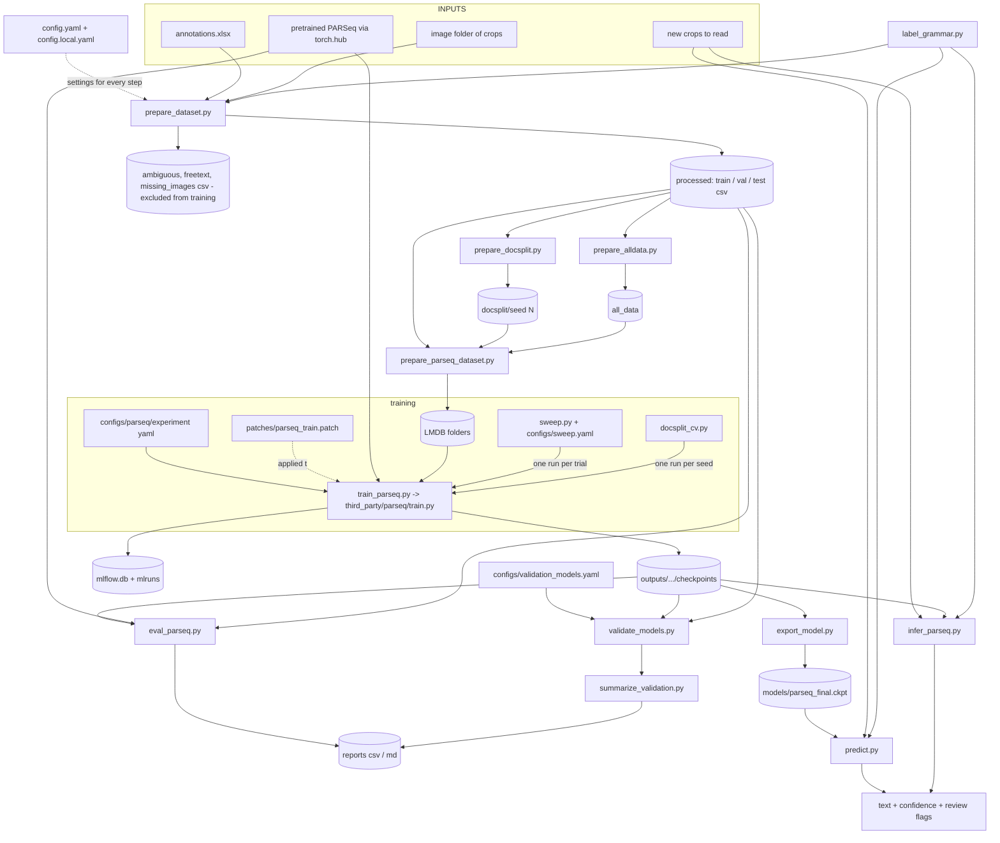

# Codebase guide: data flow and configuration

One document to understand (1) what every folder and script does, (2) how data moves from raw inputs to a deployed
model and back out as predictions, and (3) **where every tunable value lives**, so anyone can adapt the repo to their
own machine and data by editing config files only. See [section 5](#5-what-is-configurable-and-what-is-not) for the
exact list of what is and is not configurable.

Related docs: [README.md](../README.md) (setup and results), [CODEBASE_OVERVIEW.md](CODEBASE_OVERVIEW.md) (older
per-file notes), [PARSEQ_REPLICATION.md](PARSEQ_REPLICATION.md) (rebuild on a new machine),
[EMNIST_EXPERIMENTS.md](EMNIST_EXPERIMENTS.md) (the synthetic-data side experiment).

---

## 1. What the project does

Fine-tunes **PARSeq** (a scene-text recognition model from `baudm/parseq`) to read short handwritten annotation
crops such as `6`, `12b`, `(iv)`, `3.`. Labels come from an Excel workbook; images are single-crop PNG/JPGs.
Output is a checkpoint that turns a crop into `(text, confidence, matches_label_grammar)`.

Two Python environments are used:

| Environment | Installed from | Used by |
|---|---|---|
| `.venv` (main) | `requirements.txt` (pandas, openpyxl, pillow, pyyaml, numpy, tqdm) | data preparation only |
| `venv_parseq` | `requirements-parseq.txt` (torch, lightning, hydra, lmdb, mlflow, optuna, ...) | everything that touches a model |

`third_party/parseq/` is a clone of the upstream PARSeq repo (gitignored). Our edits to it live in
`patches/parseq_train.patch`, applied once with `git apply`.

---

## 2. Repository map

```
config.yaml                  ALL project settings: data source, split, folders, label rules, thresholds (committed defaults)
config.local.yaml            YOUR machine-specific overrides (gitignored; template: config.example.local.yaml)
configs/
  parseq/experiment/         Hydra training recipes: parseq_handwriting.yaml, parseq_handwriting_fixed.yaml
  sweep.yaml                 hyperparameter-search ranges and defaults
  validation_models.yaml     which checkpoints the validation report compares
patches/parseq_train.patch   our edits to third_party/parseq (seed, early stopping, MLflow, SWA switch, final.ckpt)
src/common/                  config loader, data prep, validation metrics (pandas/numpy only)
src/parseq/                  LMDB build, training launcher and drivers (sweep, CV), evaluation, export, inference
src/emnist/                  optional synthetic-data experiments
third_party/parseq/          upstream model code + its default configs   (gitignored, not ours)
data/  outputs/  models/  reports/  mlruns/  mlflow.db     generated artifacts   (gitignored; locations set in config.yaml)
```

### Script inventory

| Script | Environment | What it does | Reads | Writes |
|---|---|---|---|---|
| `src/common/project_config.py` | either | Loads `config.yaml` + `config.local.yaml`; helpers for paths, temp/cache env, the training command. Imported by every script | config files | -- |
| `src/common/prepare_dataset.py` | main | Cleans labels, drops ambiguous / free-text / missing-image rows, shuffles, splits at random per crop | `image_dir`, `annotation_file`, `split.*`, `labels.*` | `paths.processed_dir/{train,val,test,ambiguous,freetext,missing_images}.csv` |
| `src/common/prepare_docsplit.py` | either | Re-splits so every **document** lands in exactly one of train/val/test | processed splits | `paths.docsplit_dir/seed<N>/{train,val,test}.csv` |
| `src/common/prepare_alldata.py` | either | Puts every labelled crop into `train` for the final production model | processed splits | `paths.all_data_dir/*.csv` |
| `src/common/label_grammar.py` | either | Compiles `labels.clean_pattern`, the single definition of a "valid" label; imported, not run | config | -- |
| `src/parseq/prepare_parseq_dataset.py` | parseq | Packs split CSVs and their images into LMDB, the format PARSeq trains from | split CSVs, images | `<output-dir>/{train,val,test}/<lmdb.dataset_name>/data.mdb` |
| `src/parseq/train_parseq.py` | parseq | Launches one training run with the project's folders, temp settings and MLflow location applied | recipe yaml, LMDB | `outputs/.../checkpoints/`, `mlflow.db` |
| `third_party/parseq/train.py` (patched) | parseq | The trainer itself. Not our file; driven by `configs/parseq/experiment/*.yaml` | LMDB, config | checkpoints, MLflow |
| `src/parseq/sweep.py` | parseq | Optuna hyperparameter search; one training run per trial | `configs/sweep.yaml`, recipe | `paths.outputs_dir/sweeps/`, `paths.reports_dir/sweep_<study>.csv` |
| `src/parseq/docsplit_cv.py` | parseq | Document-level cross-validation: per seed, split, LMDB, train, score | processed splits, recipe | fold folders, `paths.reports_dir/docsplit_cv*.csv` |
| `src/parseq/export_model.py` | parseq | Slims a checkpoint to weights only and checks identical outputs | a `.ckpt` | `<out>/<name>.ckpt` |
| `src/parseq/model_io.py` | parseq | Shared model loading, image preprocessing and confidence decoding | -- | -- |
| `src/parseq/eval_parseq.py` | parseq | Scores a checkpoint (or the pretrained model) on a CSV: accuracy, CER, flagged share | a CSV, a `.ckpt` | stdout, optional per-sample CSV, optional MLflow metrics |
| `src/parseq/validate_models.py` | parseq | Runs every model in `validation_models.yaml` over train/val/test | processed splits, `configs/validation_models.yaml` | `paths.reports_dir/validation/<model>__<split>.csv` |
| `src/common/summarize_validation.py` | either | Turns those CSVs into the comparison tables | validation CSVs | `paths.reports_dir/model_validation.{csv,md}` |
| `src/parseq/predict.py` | parseq | Production inference on one image (importable) | image, `inference.checkpoint` | stdout / return value |
| `src/parseq/infer_parseq.py` | parseq | Inference on one image or a folder, any checkpoint | image(s), optional `.ckpt` | stdout, optional CSV |
| `src/emnist/*` | parseq | Synthetic EMNIST-based data experiments; not needed for the main pipeline | EMNIST zip, real splits | `data/emnist*/`, reports, `models/archive/` |

---

## 3. Data flow

### 3.1 Overview



### 3.2 Walk-through by stage

**A. Raw data to clean splits** (`prepare_dataset.py`, main venv)

1. Reads `image_dir`, `annotation_file`, and the two column names from the config.
2. Loads the workbook, keeps the filename and label columns, strips whitespace.
3. Removes Excel line-break artifacts (`labels.excel_artifact_pattern`) from labels; the row is kept.
4. Drops rows with an empty label. Rows whose label is in `labels.ambiguous_markers` go to `ambiguous.csv`.
5. Rows whose label does not match `labels.clean_pattern` go to `freetext.csv`. These are real content but outside
   the vocabulary the model is meant to learn.
6. Rows whose image file does not exist go to `missing_images.csv`.
7. Shuffles the rest with `split.seed`, splits by `split.train/val/test`, and writes the three CSVs with columns
   `filename, image_path, text` into `paths.processed_dir`. **Duplicates are kept on purpose.**

**B. Alternative splits** (either venv)

- `prepare_docsplit.py`: pools all three CSVs, extracts the document id (first group of `labels.doc_id_pattern`)
  from each filename, then tries `docsplit.tries` random assignments of whole documents to splits and keeps the one
  that best balances split sizes and label coverage. Result: test measures generalization to **unseen documents**.
- `prepare_alldata.py`: for the final model, all labelled crops go into `train`. Its `val`/`test` are copies of
  `val.csv` and only exist so the trainer has something to log; they say nothing about generalization.

**C. Packing to LMDB** (`prepare_parseq_dataset.py`, parseq venv)

Reads each split CSV, opens every image to validate it, and writes `image-000000001` / `label-000000001` keys plus
`num-samples` into an LMDB per split, under `<output-dir>/<split>/<lmdb.dataset_name>/`. PARSeq's data loader finds
any `data.mdb` below the root, so the folder name only has to match the recipe's `data.train_dir`.

**D. Training** (`train_parseq.py` -> `third_party/parseq/train.py` with our patch)

Hydra merges configs in this order, later overriding earlier:

1. upstream defaults in `third_party/parseq/configs/`
2. the chosen `configs/parseq/experiment/<name>.yaml`, which pins the values that matter for reproducibility
   (image size, max label length, charset, augmentation, optimizer settings, seed)
3. project defaults added by the launcher from `config.yaml` (LMDB folder, dataset folder name, MLflow store)
4. command-line overrides such as `model.lr=1e-3`

The patch adds: a configurable random seed, optional early stopping (an `early_stopping:` block), MLflow logging
including system metrics (store location from the `mlflow_db` key), an SWA on/off switch, the augmentation-strength
settings, and it always saves `final.ckpt` (the true last-epoch weights) next to the best-validation checkpoints.
Every run writes its resolved config to `outputs/.../config/`.

Two recipes exist: `parseq_handwriting.yaml` (up to 50 epochs, early stopping, used for exploration and sweeps) and
`parseq_handwriting_fixed.yaml` (fixed 15 epochs, no early stopping, no SWA, used for the final model and CV folds).

**E. Drivers that call the trainer repeatedly**

- `sweep.py`: Optuna samples hyperparameters from `configs/sweep.yaml`, launches training with overrides, reads the
  best `val_accuracy` from the checkpoint filename, and deletes every checkpoint except the best trial's. Trial 0 is
  the recipe's own values, read from its yaml.
- `docsplit_cv.py`: for each seed, runs stages B, C and D, scores the best (or `final.ckpt`) checkpoint on the
  train/val/test of that fold through `eval_parseq.py`, keeps only that checkpoint, and reports mean +- std.

**F. Deployment**

`export_model.py` drops optimizer state from the final checkpoint (about 4x smaller) and asserts the slim copy
predicts identically. The output path must contain `parseq`, because PARSeq's loader infers the model class from it.

**G. Evaluation and inference**

- All four model-running scripts share `model_io.py`: resize to the checkpoint's own image size, normalize, run the
  model, decode. **Confidence** is the smallest per-character probability in the predicted string.
- `predict.py` / `infer_parseq.py` do the same for new crops and also test the prediction against the label grammar.
  The grammar check catches confident-but-nonsense outputs that a confidence threshold misses.
- Review flagging uses `inference.flag_threshold` (default 0.5) everywhere: `eval_parseq.py` and
  `summarize_validation.py` count flagged samples, `predict.py` and `infer_parseq.py` mark a prediction for review
  when its confidence is below it or it fails the grammar.

### 3.3 The three input types and where each goes

| Input | Enters at | Passes through | Ends up as |
|---|---|---|---|
| Labelled data (`.xlsx` + images) | `prepare_dataset.py` | splits, LMDB, training | checkpoints, then `models/parseq_final` |
| Unlabelled crops to read | `predict.py` / `infer_parseq.py` | the exported model and the grammar check | text, confidence, review flags |
| Pretrained PARSeq weights | `torch.hub` (`baudm/parseq`) | training start point (`pretrained: parseq`), or zero-shot evaluation | fine-tuned checkpoint, or a baseline score |

---

## 4. Where configuration lives

| Layer | Files | Controls |
|---|---|---|
| 1. `config.yaml` | committed portable defaults, read by every script | data source, split, **all folders**, temp/cache drives, label rules, LMDB settings, document-split settings, inference checkpoint and review threshold, validation-report settings |
| 2. `config.local.yaml` | yours, gitignored, merged on top of layer 1 | anything that differs on your machine (image folder, annotation file, `env.tmp_dir`) |
| 3. `$PROJECT_CONFIG` | optional extra file, merged last | one-off variants of a run |
| 4. Hydra experiment YAMLs | `configs/parseq/experiment/*.yaml` | model and training hyperparameters, pinned upstream defaults, seed, MLflow experiment name |
| 5. `configs/sweep.yaml` | hyperparameter-search ranges, recipe used, sweep defaults | |
| 6. `configs/validation_models.yaml` | models compared in the validation report | |
| 7. Command-line flags | `argparse` in each script | per-run overrides; their **defaults come from layers 1 to 3** |

Merge order for the project config: `config.yaml`, then `config.local.yaml`, then `$PROJECT_CONFIG`. Sections merge key
by key, so `config.local.yaml` only needs the keys you change.

---

## 5. What is configurable and what is not

### 5.1 Controlled from config files

| Setting | Where |
|---|---|
| Image folder, annotation file, label and filename columns | `config.yaml` / `config.local.yaml` |
| Random split ratios and seed | `split:` |
| Every input/output folder (processed, LMDB, all-data, doc-splits, outputs, reports, models, MLflow db) | `paths:` |
| Temp/cache drive for training subprocesses | `env:` |
| Label grammar, ambiguous markers, Excel-artifact pattern, document-id pattern | `labels:` |
| LMDB dataset folder name and map size | `lmdb:` |
| Document-split seed, search tries, CV seeds | `docsplit:` |
| Production checkpoint, review threshold | `inference:` |
| Validation batch size, rare-label cut-off, bootstrap and calibration settings | `validation:` |
| Learning rate, dropout, batch size, epochs, augmentation, weight decay, warm-up, permutations, gradient clipping, seed | experiment YAMLs |
| Image size, max label length, charset (pinned upstream defaults) | experiment YAMLs |
| Early stopping, SWA, pretrained weights, MLflow experiment name, system-metrics interval | experiment YAMLs |
| Sweep ranges, sweep recipe, trials, epochs, patience, disk guard | `configs/sweep.yaml` |
| Models in the validation report | `configs/validation_models.yaml` |

### 5.2 Still in code, by design or deliberately left

| What | Where | Why it is left |
|---|---|---|
| Image normalization `Normalize(0.5, 0.5)` and bicubic resize | `src/parseq/model_io.py` (one copy) | Must match how PARSeq was trained; changing it needs retraining, so it is a code fact rather than a user setting |
| Model architecture (embed dim 384, 12 encoder layers, ...) | `third_party/parseq/configs/model/parseq.yaml` | Fixed by the pretrained weights. Overridable, but changing it discards the pretraining |
| Fixed subfolder names under configured folders (`validation/`, `sweeps/`, `parseq_docsplit<tag>/seed<N>`, `parseq_emnist/`) | drivers | Structure, not settings: the base folders are configurable |
| MLflow experiment names for CV and EMNIST runs (`parseq_docsplit`, `parseq_emnist`) | `docsplit_cv.py`, `run_experiments.py` | Names of experiments, not tunables |
| Best-checkpoint selection by parsing `val_accuracy=` from the file name | `sweep.py`, `docsplit_cv.py` | Depends on PARSeq's checkpoint naming |
| The document-split scoring rule (size error minus label coverage) | `prepare_docsplit.py` | Algorithm; its knobs (`tries`, ratios, seed) are configurable |
| EMNIST experiment definitions (run names, epochs, data folders) and the synthetic-data recipe (glyph heights, sequence templates, augmentation ranges) | `src/emnist/run_experiments.py`, `synth_sequences.py`, `extract_emnist.py` | Optional side experiment, described in `EMNIST_EXPERIMENTS.md`; its own data folders are `data/emnist*` |
| Optuna sampler (TPE) and objective (maximize `val_accuracy`) | `sweep.py` | Method choice |

### 5.3 Duplication that remains

| Duplicated thing | Where | Note |
|---|---|---|
| Dataset folder name `handwriting` | `lmdb.dataset_name` in `config.yaml` and `data.train_dir` in the experiment YAMLs | Drivers and the launcher pass the config value to Hydra, so they stay in sync. Only a hand-typed `train.py` command uses the YAML value, and the two defaults are equal |
| Hyperparameters in the two recipe YAMLs | `parseq_handwriting.yaml`, `parseq_handwriting_fixed.yaml` | Intentionally parallel recipes; the sweep baseline is now read from the recipe instead of a third copy |

---

## 6. Cheat sheet: how do I change ...?

| I want to change ... | Do this |
|---|---|
| Where my images / annotations are | `image_dir`, `annotation_file` in `config.local.yaml`; rerun `prepare_dataset.py` |
| Which drive holds temp files / the torch cache | `env.tmp_dir`, `env.torch_home` in `config.local.yaml` |
| Where data, outputs, reports or models go | `paths:` in `config.yaml` |
| Train/val/test ratios (random split) | `split:` |
| Learning rate, dropout, batch size, epochs, augmentation | The experiment YAML, or override: `python src/parseq/train_parseq.py --experiment parseq_handwriting_fixed model.lr=1e-3` |
| Turn early stopping on or off | Include or remove the `early_stopping:` block in the YAML |
| Image size, max label length, charset | `model.img_size`, `model.max_label_length`, the `/charset` default, in the experiment YAML |
| Which model to start from | `pretrained:` in the YAML |
| The valid label format | `labels.clean_pattern` in `config.yaml` (affects cleaning and inference together) |
| The human-review confidence cut-off | `inference.flag_threshold` in `config.yaml` |
| The production model used by `predict.py` | `inference.checkpoint` |
| Sweep ranges, trials, epochs | `configs/sweep.yaml` |
| Which models the validation report compares | `configs/validation_models.yaml` |
| Run something once with different settings | Put the keys in a file and set `PROJECT_CONFIG=that_file.yaml` |

### Typical end-to-end run (final model)

```bash
# one-time: copy config.example.local.yaml to config.local.yaml and set image_dir / annotation_file

# main venv
python src/common/prepare_dataset.py                       # config -> paths.processed_dir
python src/common/prepare_alldata.py                       # processed -> paths.all_data_dir

# venv_parseq
venv_parseq/Scripts/python src/parseq/prepare_parseq_dataset.py --processed-dir data/all_data --output-dir data/all_lmdb
venv_parseq/Scripts/python src/parseq/train_parseq.py --experiment parseq_handwriting_fixed \
    data.root_dir=data/all_lmdb hydra.run.dir=outputs/parseq_final/run seed=42
venv_parseq/Scripts/python src/parseq/export_model.py \
    --checkpoint outputs/parseq_final/run/checkpoints/final.ckpt --out models/parseq_final
venv_parseq/Scripts/python src/parseq/predict.py "path/to/crop.png"
```

For an honest accuracy estimate (unseen documents), use `docsplit_cv.py` instead of the all-data model's own
numbers: the all-data model has seen every crop, so its score on them is not a generalization measure.

---

## 7. How the refactor was verified

The config-driven scripts were checked against the previous behaviour, not just run:

- `prepare_dataset.py`, `prepare_docsplit.py` (seed 42) and `prepare_alldata.py` regenerate **byte-identical** CSVs
  to the previously committed outputs.
- `eval_parseq.py` reproduces the archived `base_best` model's 96.83% exact-match and 2.88% CER on the seed-42 test split.
- The fully composed Hydra configs of both recipes differ from before only by the two added keys (`seed`, `mlflow_db`).
- The sweep baseline derived from each recipe equals the old hardcoded baseline for both search spaces.
- One-epoch runs of `sweep.py`, `train_parseq.py` and `docsplit_cv.py` (split, LMDB, train, score) completed against
  scratch folders, logging to a scratch MLflow store.
- The updated `parseq_train.patch` applies cleanly to a pristine upstream clone.
